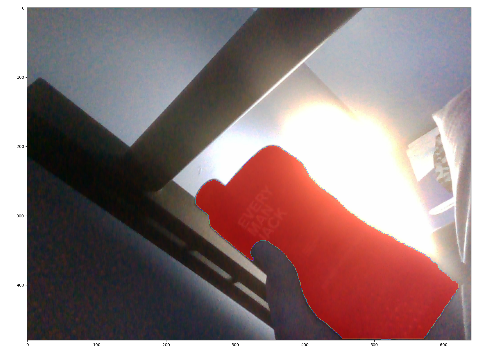
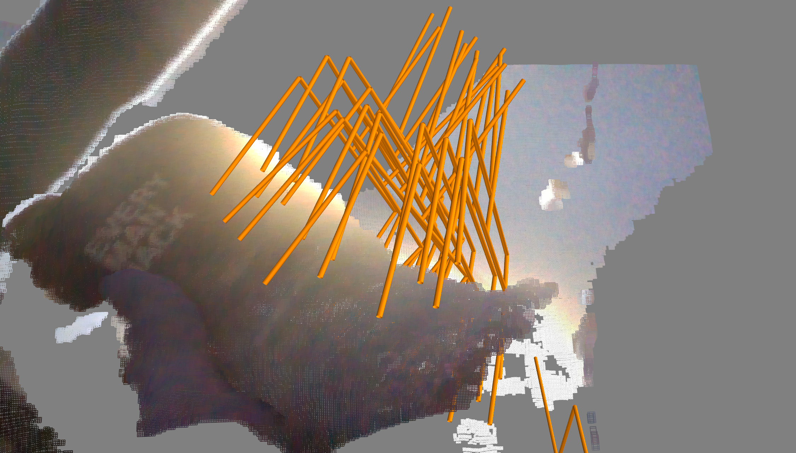

# Robot-to-Human Handover

## Progress

**Working:** RealSense RGB and aligned depth, target segmentation with SAM3, a ROS 2 bridge that saves the selected object's RGB/depth/mask/camera intrinsics to `shared/cgn/input.npz`, and manual Contact-GraspNet inference with grasp visualization.

**Still to do:** Automate CGN run after an input is ready, publish its grasp candidates, select grasps suitable for a human receiver, and execute the robot handover. 

## Example

The text prompt provided to SAM3 was **"bottle"**. SAM3 segmented the target object, and the RGB-D data and segmentation mask were used by Contact-GraspNet to generate 6-DoF grasp candidates.

### SAM3 Target Segmentation



### Contact-GraspNet Grasp Generation



## Project layout

```text
robot-handover/
├── sam3_cgn/
│   ├── Dockerfile
│   ├── compose.yaml
│   ├── ros2_ws/src/             # sam3_ros, cgn_ros, perception_interfaces, realsense (clone from https://github.com/realsenseai/realsense-ros.git)
│   ├── sam3/                    # upstream SAM3; (not tracked)
│   └── huggingface_cache/       # model downloads; (not tracked)
├── contact_graspnet/
│   ├── Dockerfile
│   ├── compose.yaml
│   └── contact_graspnet/        # upstream NVIDIA repo; (not tracked)
└── shared/cgn/                  # data shared between containers
```

## Setup

### Download the model repositories

Clone this project, then get the upstream models (their source and weights are not included here):

```bash
git clone https://github.com/muhammedahmedd/robot-handover.git
cd robot-handover

git clone https://github.com/facebookresearch/sam3.git sam3_cgn/sam3
git clone https://github.com/NVlabs/contact_graspnet.git contact_graspnet/contact_graspnet
```

**SAM3:** Follow the [official SAM3 instructions](https://github.com/facebookresearch/sam3) for Hugging Face model access and authentication. Its checkpoint cache is mounted from `sam3_cgn/huggingface_cache/` 

**Contact-GraspNet:** Follow the [NVIDIA repository instructions](https://github.com/NVlabs/contact_graspnet) to download its pretrained checkpoint, and place `scene_test_2048_bs3_hor_sigma_001` under `contact_graspnet/contact_graspnet/checkpoints/`.

### Build the Docker environments

Each directory has its own Dockerfile and Compose file:

```bash
cd sam3_cgn
docker compose build
docker compose up -d

cd ../contact_graspnet
docker compose build
docker compose up -d
```

Both Compose files mount `../shared/cgn` to `/shared/cgn`. 

### Build the ROS 2 workspace

Inside the SAM3 container:

```bash
docker exec -it sam3_cgn bash
source /opt/ros/jazzy/setup.bash
cd /workspace/sam3_cgn/ros2_ws
colcon build --symlink-install
source install/setup.bash
```

Install SAM3's Python package inside this container following its upstream instructions if it is not already installed bu running 

```bash
pip3 install --break-system-packages -e /workspace/sam3_cgn/sam3
```
cloning the source alone is not sufficient.

## Run the pipeline (current manual workflow)

Use 3 separate terminals in the SAM3 container **(I will try to minimize this by automating the process)**, in this order:

**1. Start the RealSense camera Note: the camera will later be launched from the same launch file for the robot arm**

```bash
ros2 launch realsense2_camera rs_launch.py \
  align_depth.enable:=true \
  enable_sync:=true
```

**2. Start the CGN bridge**

```bash
ros2 run cgn_ros cgn_bridge
```

**3. Start the SAM3 node**

```bash
ros2 run sam3_ros sam3_node
```

Once SAM3 publishes the target mask on `/sam3/target_seg`, the bridge pairs it with aligned depth and saves `shared/cgn/input.npz`. **Stop the SAM3 node manually after confirming that file was generated**, to free GPU memory for Contact-GraspNet.

**4. Run Contact-GraspNet inference**

In a terminal inside the CGN container:

```bash
docker exec -it contact_graspnet bash
cd /workspace/contact_graspnet
python contact_graspnet/inference.py \
  --np_path=/shared/cgn/input.npz \
  --ckpt_dir=checkpoints/scene_test_2048_bs3_hor_sigma_001 \
  --local_regions --filter_grasps
```

The original script saves its output to `results/predictions_input.npz` in the Contact-GraspNet repository and can open interactive grasp visualizations. 

## Contact-GraspNet CUDA compilation note

Contact-GraspNet uses custom C++ and CUDA operations from PointNet++ to process 3D point clouds. The original compiled .so files were not compatible with our CUDA 11.8 environment, so I had to recompile these three files:

```text
pointnet2/tf_ops/3d_interpolation/tf_interpolate_so.so
pointnet2/tf_ops/grouping/tf_grouping_so.so
pointnet2/tf_ops/sampling/tf_sampling_so.so
```

Although the original Contact-GraspNet repository was tested with CUDA 11.1, I used CUDA 11.8 because my NVIDIA RTX 4060 uses newer architecture, so CUDA 11.8 was a more suitable choice for our hardware.

To compile the operators successfully, I also changed the C++ compiler flag from -std=c++11 to -std=c++17.

The recompiled .so files are not included in this GitHub repository. They may need to be rebuilt when setting up Contact-GraspNet on another computer.

To rebuild the operators, run the following commands inside the Contact-GraspNet container:

```bash
docker exec -it contact_graspnet bash
cd /workspace/contact_graspnet

sed 's/-std=c++11/-std=c++17/g' \
    compile_pointnet_tfops.sh \
    > compile_pointnet_cuda118.sh

bash compile_pointnet_cuda118.sh
```


